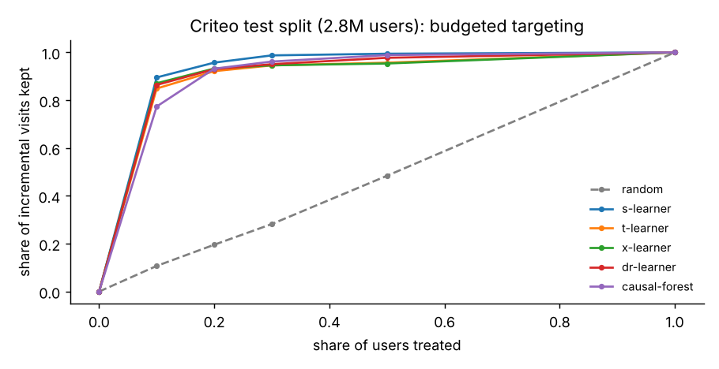

# Causal Uplift on the Criteo Trial

Who should receive an ad, when the question is not "who will visit" but "who will visit *because of* the ad".

The Criteo uplift dataset is a randomised trial: 14M users, 85% shown advertising and 15% held out, with the visit and conversion each user went on to make. On a trial the effect of the treatment can be measured without assumptions about who got it, so this repository fits five uplift models, ranks users by their predicted individual effect, and measures on held-out users how much of the campaign's total effect a targeted campaign keeps while treating only a fraction of them.

## Results

All numbers are from [docs/results.json](docs/results.json): 13,979,592 rows, models fitted on a 2M-row sample of the training split, evaluated on the **whole test split (2,796,413 users)**.

**The trial.** 85% treated. Visit rate 3.82% in control and 4.85% under treatment: an average effect of **+1.03 points** [1.006, 1.063], a 27% relative lift. Regression adjustment in DoWhy gives +0.68 points on a 1M-row sample; the gap is the covariate imbalance between arms (largest standardised mean difference 0.049, on `f3`), which the adjustment corrects. The placebo refuter returns +0.00004, the random-common-cause and subset refuters leave the estimate where it was.

**Targeting.** Treating the users each model ranks first, valued on held-out users by inverse propensity weighting:



| Learner | AUUC test [95% CI] | Treat 10%: visits kept | Treat 30%: visits kept | Fit (2M rows) |
|---|---|---|---|---|
| random | −0.00013 [−0.00031, 0.00006] | 11% | 28% | – |
| S-learner | **0.00376** [0.00347, 0.00400] | **90%** | **99%** | 5 s |
| T-learner (best on validation) | 0.00355 [0.00324, 0.00382] | 85% | 95% | 5 s |
| X-learner | 0.00357 [0.00331, 0.00380] | 87% | 95% | 11 s |
| DR-learner | 0.00370 [0.00342, 0.00396] | 86% | 95% | 25 s |
| Causal forest (1M rows) | 0.00361 [0.00336, 0.00385] | 77% | 96% | 128 s |

The effect of advertising here is concentrated: a tenth of the users carries 85 to 90% of all the extra visits, so a campaign aimed by any of these models keeps nearly the whole effect for a tenth of the impressions. The learners themselves are close: paired bootstrap intervals for each one against the S-learner all include zero except the causal forest, slightly below it. The model selected on validation (T-learner) is not the best on test, and the README says so rather than picking the winner after the fact.

**Out of core.** CSV to Parquet with the split column in 38 s through DuckDB; the trial facts as SQL in 0.5 s; the selected model scores all 13,979,592 rows in Polars batches in 21 s.

**A correction worth keeping.** A first run ranked tied scores by a stable sort, so users with the same score were ordered as they sit in the file. The S-learner gives large groups the same score, and its test AUUC fell outside its own bootstrap interval. Ties are now broken at random with a fixed seed everywhere, `tests/test_metrics_and_policy.py` checks that a constant score on a file sorted by outcome still looks like random targeting, and the table above is the corrected run.

## Pipeline

```
python scripts/fetch_criteo.py      # 14M rows, CSV -> Parquet through DuckDB
python scripts/run_pipeline.py      # everything else, logged to MLflow
mlflow ui --backend-store-uri sqlite:///mlflow.db
```

1. **Out of core.** The CSV is streamed through DuckDB into one Parquet file with a row id and a split column (70/10/20 by a hash of the id, so it never depends on file order). Trial facts are SQL aggregates over that file: rates per arm, the average treatment effect with its interval, and the standardised mean difference of every feature between arms. Models are fitted on samples drawn by DuckDB, and the test split and the full table are scored in bounded Polars batches.
2. **Identification.** The average effect is written as a DoWhy causal model and stress-tested with a placebo treatment, a random common cause and data subsets.
3. **Tuning.** LightGBM hyperparameters are chosen by Optuna (30 trials) on validation AUUC and shared by every learner; `--params` reuses a saved set.
4. **Learners.** S-learner, T-learner, X-learner, DR-learner and a causal forest (EconML `CausalForestDML`), against random targeting. The propensity is the known treated share, since the trial is randomised.
5. **Evaluation on the whole test split.** AUUC (area between the uplift curve and random targeting, per user), Qini coefficient, uplift in the top 10% and 30%, and 200-resample paired bootstrap intervals, computed as draw counts over the fixed ranking so a resample of 2.8M rows takes 0.3 s.
6. **Policy.** Treat the top *k*% by predicted uplift, valued on held-out users by inverse propensity weighting, which is unbiased on a randomised trial. The economics are simulated: one extra visit is worth 1, one treatment costs 0.002.

## Data

Diemert, Betlei, Renaudin, Amini, *A Large Scale Benchmark for Uplift Modeling*, AdKDD 2018. Criteo AI Lab, CC BY-NC-SA 4.0. Downloaded by `scripts/fetch_criteo.py`, never committed.

## Running without the data

```
python scripts/fetch_criteo.py --synthetic 200000
python scripts/run_pipeline.py --data data/synthetic.parquet --quick
pytest -q
```

The synthetic set has the Criteo schema and a known individual effect, which is what the tests use to check that the metrics reward the right ranking and that the policy estimate recovers the true value. CI runs the tests, ruff, the synthetic pipeline end to end and the Docker image on every push.

## Licence

MIT for the code. The data carries its own licence.
